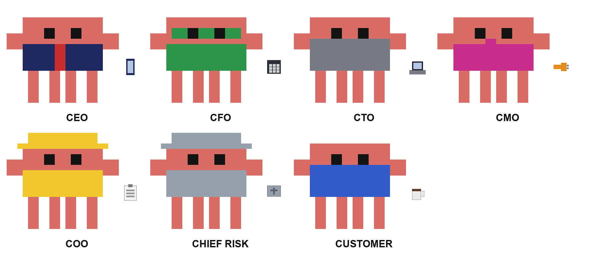

# council

A skill that makes you think like a company instead of like one guy at 2am.

Give it a decision, it seats a 7-person board (Customer, CFO, CTO, CMO, COO, Chief Risk, CEO),
makes them disagree, runs a pre-mortem, votes, and returns **one owned decision** with a
kill-switch date and a first move you can do in 48h. Every call is written to `decisions/`.

This skill is **portable** — it runs unchanged on Claude Code, Hermes, and OpenClaw.
Only the install path and trigger command differ.

## The board (who's in the room)

| # | Seat | Wears / role | What they ask | Falsifier (what flips them) |
|---|------|--------------|---------------|-----------------------------|
| 1 | **Customer** *(empty chair, speaks first)* | Plain clothes, never heard of you | "What breaks in my week if this doesn't exist?" | 5 people naming the pain unprompted |
| 2 | **CFO** | Green visor, calculator | Payback period, not revenue; cost if it works vs. if it doesn't | Unit economics on one line |
| 3 | **CTO** | Gray hoodie, laptop | Thinnest version that proves the risky part; hates rewrites | A 1-day spike result |
| 4 | **CMO** | Magenta blazer, megaphone | First 100 users *by name or channel*; "build" isn't distribution | One channel with measured conversion |
| 5 | **COO** | Yellow hard hat, clipboard | What gets dropped to make room; who does it while you sleep | The current WIP count |
| 6 | **Chief Risk** | Steel helmet, shield | Writes the 90-day failure story; veto on one-way doors only | A cheap way to make the door two-way |
| 7 | **CEO** *(decides)* | Navy suit, red tie | "Which makes the next decision easier?" — owns it, may overrule | None; carries the consequence instead |

Small/cheap decision → cut the board to **CEO + CFO + Customer**.

### The mascot — one character, seven outfits

*(The council creature — your pixel sprite — dressed for each seat. Labels: CEO, CFO, CTO, CMO, COO, CHIEF RISK, CUSTOMER.)*

## Install

> The skill folder must be named `council` (matching `name:` in SKILL.md). The source folder
> here is named "the council " with a trailing space; the commands below copy it and rename it.

### Hermes
```bash
cp -r "the council " ~/.hermes/skills/council
```
Then: `skill_view(name='council')` — or just ask "should I build X?" and it triggers.

### Claude Code
```bash
cp -r "the council " ~/.claude/skills/council
```
Then: `/council` (slash command) or let Claude auto-activate it on a matching request.
`effort: high` in the frontmatter raises Claude's reasoning budget for the council.

### OpenClaw / ClawHub
```bash
clawhub install council          # or import the GitHub repo via the web importer
```
Trigger: natural language — the `description` field is matched against your request.
For ClawHub publishing the license is MIT-0; drop the copyright line in LICENSE if you publish.

## Layout
```
council/
  SKILL.md              procedure: frame → seat → red team → vote → decide → record
  references/seats.md   the 7 seats + optional guests (Legal, Competitor, Chief Scientist)
  templates/decision.md the written record
  decisions/            your decision log (kill-switch tracked)
  assets/council.png    original board art
  assets/claude-mascot.png  the mascot in 7 seat outfits
```

## Why it works
- Seats are **paid to disagree** — no single-brain bias.
- Every opinion needs a **falsifier**, or it's struck.
- Every decision needs a **kill-switch** — no zombie projects.
- The board is short. Long board meetings are theatre.

## License
MIT — Copyright (c) 2026 Soljunge. (ClawHub publishes under MIT-0; no attribution required there.)
