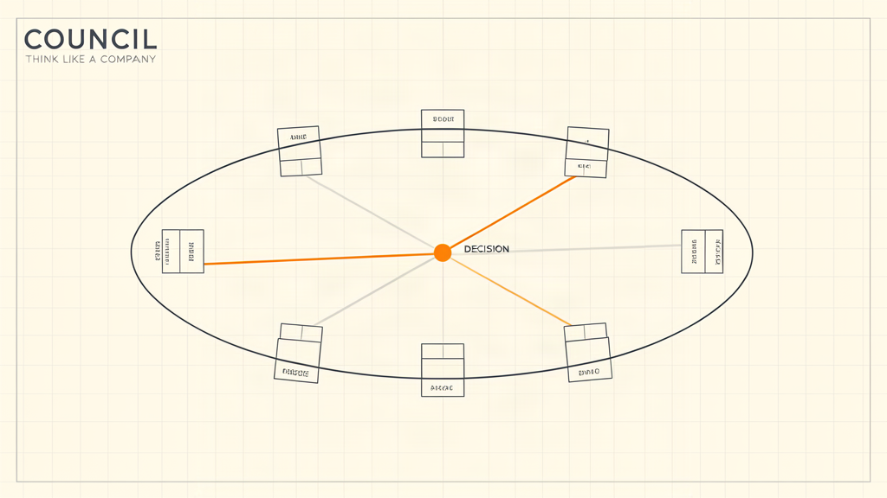

# council



A skill that makes you think like a company instead of like one guy at 2am.

Give it a decision, it seats a 7-person board (Customer, CFO, CTO, CMO, COO, Chief Risk, CEO),
makes them disagree, runs a pre-mortem, votes, and returns **one owned decision** with a
kill-switch date and a first move you can do in 48h. Every call is written to `decisions/`.

## Install
Copy into your skills dir:

```bash
cp -r ~/ceo/Hacker/council ~/.hermes/skills/council
```

Then: `skill_view(name='council')` — or just ask "should I build X?" and it triggers.

## Layout
```
council/
  SKILL.md              procedure: frame → seat → red team → vote → decide → record
  references/seats.md   the 7 seats + optional guests (Legal, Competitor, Chief Scientist)
  templates/decision.md the written record
  decisions/            your decision log
```

## Why it works
- Seats are **paid to disagree** — no single-brain bias.
- Every opinion needs a **falsifier**, or it's struck.
- Every decision needs a **kill-switch** — no zombie projects.
- The board is short. Long board meetings are theatre.
